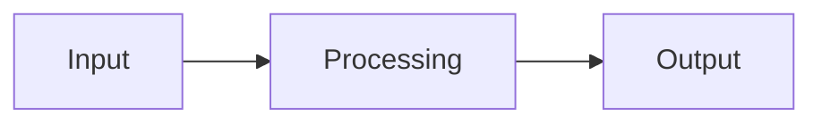

# Architecture

## Overview
<What the main components are and how they fit together. Prefer a text or Mermaid diagram so agents can read it.>

## Components
| Component | Path | Responsibility |
|---|---|---|
| | | |

## Data flow
<What moves where, formats, rates, interfaces.>

## External interfaces
<APIs, protocols, ports, devices, file formats.>
